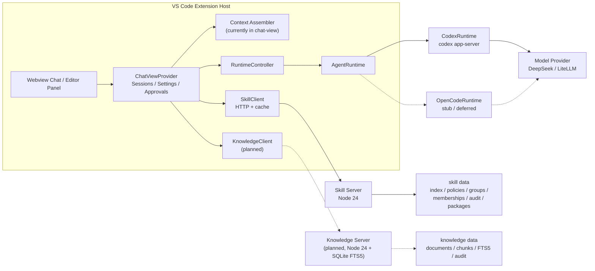
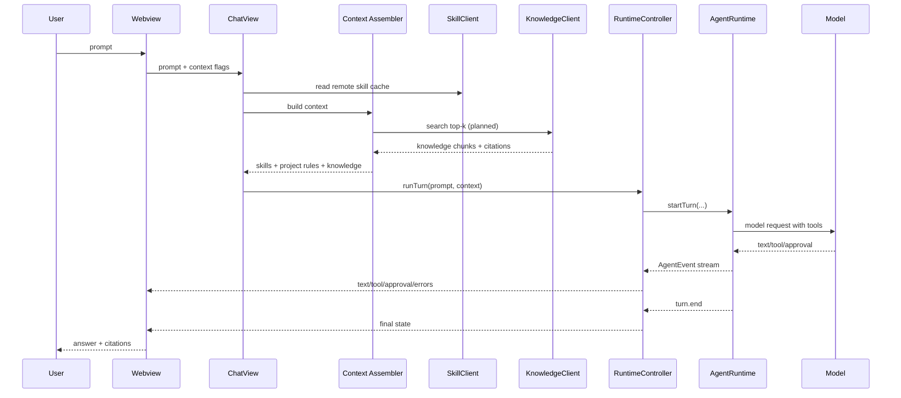
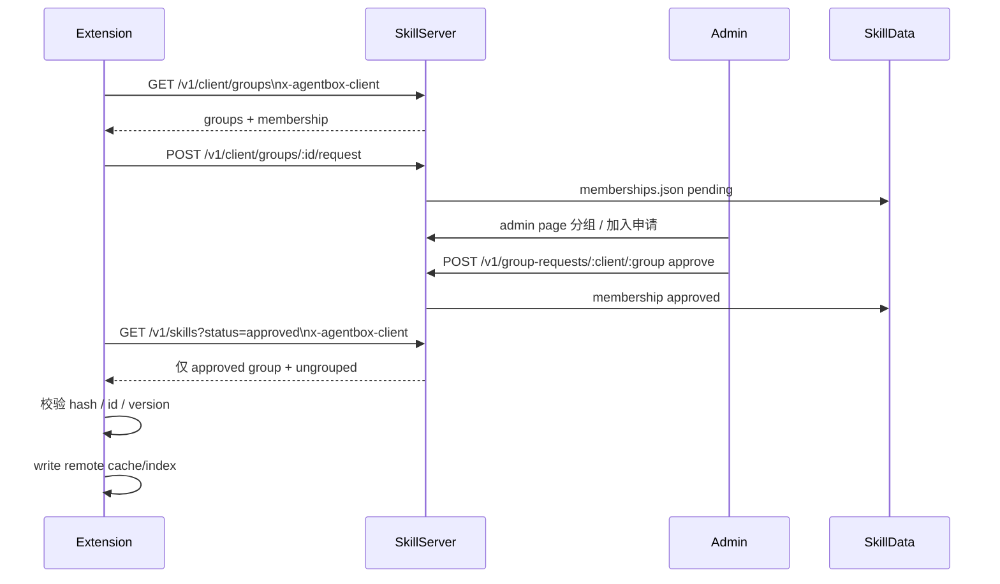
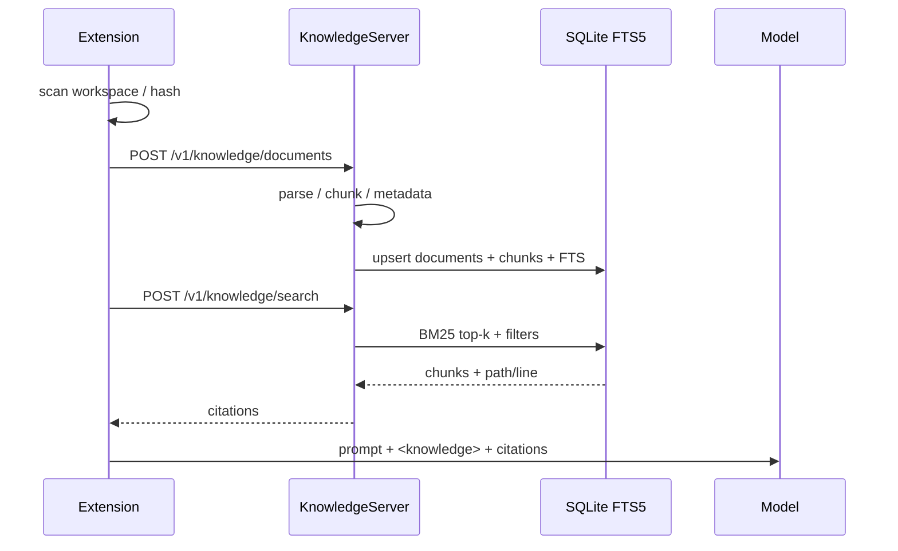

# AgentBox 系统架构

> 本文件描述 **AgentBox 整体系统**：VS Code 客户端、Agent Runtime、Skill Server、
> Knowledge Base、模型网关以及它们之间的契约。
>
> 运行时层细节见 [agent-runtime/docs/ARCHITECTURE.md](agent-runtime/docs/ARCHITECTURE.md)；
> Skill 细节见 [agent-runtime/docs/SKILL-SYSTEM.md](agent-runtime/docs/SKILL-SYSTEM.md)；
> Knowledge Base 设计见 [agent-runtime/docs/KNOWLEDGE-BASE.md](agent-runtime/docs/KNOWLEDGE-BASE.md)。
>
> 更新时间：2026-11-11。

---

## 1. 目标与边界

AgentBox 不是“再造一个 coding agent”，而是：

1. 把分散在开发人员手里的业务逻辑、规范、文档沉淀为可检索知识；
2. 把团队规范变成可版本化、可审批、可强制下发的 Skill；
3. 把 coding agent 作为可替换执行引擎，而不是产品护城河；
4. 在默认内网、可审计、最小权限的前提下工作。

核心分层：

```text
知识资产层（Skill / Knowledge）
        ↑
产品体验层（VS Code Webview / 会话 / 审批 / 引用）
        ↑
运行时层（AgentRuntime / Codex / OpenCode）
        ↑
模型与执行环境（LiteLLM / Codex sandbox / PowerShell）
```

**当前状态：**

- Skill 系统：已实现并验证；
- Knowledge Base：设计完成，待实现；
- Runtime：Codex 主，OpenCode adapter 暂缓；
- Codex Windows shell：PowerShell 5.1；Git Bash 尝试已回退。

---

## 2. 总体拓扑



### 2.1 本地开发拓扑

```text
VS Code
  └─ AgentBox extension
       ├─ codex.exe app-server (stdio)
       └─ HTTP → http://127.0.0.1:4770  skill-server
                 http://127.0.0.1:4771  knowledge-server (planned)

skill-server
  └─ .dev-data/ (或 SKILL_SERVER_DATA)

knowledge-server
  └─ .knowledge-data/ (planned)
```

### 2.2 团队/云端拓扑

```text
VS Code extension
  ├─ HTTPS → skills.example.internal
  ├─ HTTPS → knowledge.example.internal
  └─ HTTPS/stdio → model gateway / Codex

内网/云端
  ├─ skill-server (TLS reverse proxy)
  ├─ knowledge-server (TLS reverse proxy)
  ├─ LiteLLM / Qwen / DeepSeek
  └─ 持久卷 + 备份 + audit
```

---

## 3. 组件职责

### 3.1 VS Code Extension

位置：`extension/`

职责：

- 侧边栏 Webview 与编辑器面板；
- 多会话、会话 transcript、设置、审批卡片；
- Context 组装：当前文件/选区、Skill 注入、知识检索（规划）；
- 调用 `AgentRuntime`，把 `AgentEvent` 映射为 UI；
- SkillClient：远程同步、缓存、组申请；
- 不直接实现 agent loop，不直接调用模型 API。

关键边界：

- UI/Controller 只依赖 `AgentRuntime` + `AgentEvent`；
- 不把 Codex 私有类型带到 UI；
- 密钥只进 `SecretStorage`，不进入 Webview。

### 3.2 Agent Runtime

位置：`agent-runtime/`

职责：

- `AgentRuntime` 接口与统一事件；
- Codex app-server adapter（主）；
- OpenCode adapter（stub，暂缓）；
- FakeRuntime（UI 冒烟）；
- 进程生命周期、超时、取消、审批回执、Windows 进程树；
- 不 import `vscode`，不读 `pluginVersion/`。

运行时选择：

```text
agentbox.runtime = "codex" | "fake"
```

`OpenCodeRuntime` 已在 factory 中预留，但 extension 当前未启用。

### 3.3 Skill Server

位置：`skill-server/`

职责：

- Skill 包上传、不可变版本、审批；
- required / enabled（推送给 Agent）策略；
- Skill Group 管理；
- 客户端加入组申请与 admin 审批；
- 审计；
- 管理页（review / group / requests / audit）。

数据：

```text
SKILL_SERVER_DATA/
  index.json
  policies.json
  groups.json
  memberships.json
  audit.jsonl
  packages/<id>/<version>.json
```

角色：

```text
admin > reviewer > author > reader
```

### 3.4 Knowledge Server（规划）

位置：`knowledge-server/`（待创建）

职责：

- 接收 extension push 的 workspace 文档；
- parse → chunk → metadata；
- SQLite FTS5 索引；
- search API（top-k、filters、snippets）；
- citations（path / heading / line range）；
- 后续：collection ACL、embedding、hybrid retrieval。

数据：

```text
KNOWLEDGE_DATA/
  knowledge.db          # documents / chunks / FTS5
  objects/               # 可选原始文档
  audit.jsonl
```

### 3.5 模型与执行环境

- Codex：`codex app-server`，Responses API；
- 当前本机：DeepSeek `deepseek-flash`；
- 生产目标：内网 LiteLLM / Qwen3-Coder；
- Codex Windows sandbox：`:workspace`，PowerShell 5.1；
- Git Bash 在 Codex Windows sandbox 内不兼容，已回退；
- 公网模型必须显式 opt-in、告警、审计，秘密级数据禁止出网。

---

## 4. 端到端数据流

### 4.1 一次 Chat Turn



上下文顺序：

```text
内置安全/工作流
  > remote required skill
  > project AGENTS.md
  > local/optional skill
  > retrieved knowledge (K1..Kn)
  > file/selection context
  > user prompt
```

### 4.2 Skill 同步与组申请



规则：

- 未加入组的 grouped skill **不可见**；
- 未分组 skill 对所有客户端可见；
- required 仍由 policy 控制，但必须同时满足组审批；
- 客户端使用稳定 `clientId`，支持多组申请。

### 4.3 Knowledge 入库与检索（规划）



### 4.4 审批流

- Skill 上传：author → pending → reviewer/admin approve/reject/revoke；
- Skill 组申请：client reader → pending → admin approve/reject；
- Codex 工具：approval.request → 用户 allow/deny → runtime 回执；
- 被拒绝的工具不得执行；turn 可以 `policy_denied` 结束。

---

## 5. 关键契约

### 5.1 AgentRuntime / AgentEvent

- 版本：`AGENT_EVENT_SCHEMA_VERSION = 1`；
- `turn.end` 恰好一次；
- `tool.start` / `tool.end` 成对；
- `approval.request` 只表示需要审批，决定通过 `resolveApproval` 回传；
- `text.delta` 为增量；
- `token.usage` 可选；
- `file.changed.path` 为 workspace 相对 POSIX 路径。

### 5.2 Skill API

```text
GET    /healthz
GET    /v1/me
GET    /v1/skills?status=approved|pending|all
GET    /v1/skills/:id
GET    /v1/skills/:id/:version
GET    /v1/required
GET    /v1/groups
GET    /v1/client/groups
PUT    /v1/groups/:id
DELETE /v1/groups/:id
POST   /v1/client/groups/:id/request
GET    /v1/group-requests
POST   /v1/group-requests/:clientId/:groupId
POST   /v1/skills
POST   /v1/skills/:id/:version/approve|reject|revoke
PUT    /v1/skills/:id/policy
GET    /v1/audit
```

Skill 包：

```json
{
  "manifest": { "schemaVersion": 1, "id": "...", "version": "1.0.0" },
  "files": { "SKILL.md": "# ..." },
  "hash": "sha256..."
}
```

客户端校验：`hash`、`id`、`version`、`enabled`、`required`。

### 5.3 Knowledge API（规划）

```text
GET  /healthz
GET  /v1/knowledge/status
POST /v1/knowledge/documents
DELETE /v1/knowledge/documents/:id
POST /v1/knowledge/search
GET  /v1/knowledge/documents/:id
POST /v1/knowledge/reindex
GET  /v1/knowledge/audit
```

检索响应必须带：

```json
{
  "chunkId": "...",
  "docId": "...",
  "path": "docs/etl/intern_test.md",
  "heading": "3.2 增量同步",
  "startLine": 120,
  "endLine": 168,
  "snippet": "...",
  "score": 12.3
}
```

---

## 6. 存储与缓存

| 位置 | 内容 | 是否持久 |
|---|---|---|
| `~/.agentbox/skills/local/` | 本地 Skill | 是 |
| `<globalStorage>/agentbox/skills/remote/<serverHash>/` | 远端 Skill 缓存 | 是 |
| `<globalStorage>/codex-home/` | Codex 配置/日志/线程 | 是 |
| 扩展内存 | 会话 transcript / 多会话 | Reload 清空 |
| `SKILL_SERVER_DATA` | Skill index/policy/group/membership/audit/package | 是 |
| `KNOWLEDGE_DATA` | documents/chunks/FTS5/audit | 是（规划） |

---

## 7. 安全边界

```text
Zone A：开发者机器
  VS Code extension host
  codex app-server 子进程
  本地 workspace / PowerShell

Zone B：内网/云端服务
  skill-server
  knowledge-server
  LiteLLM / Qwen

Zone C：外部
  公网模型（默认关闭）
```

规则：

- 默认内网；公网模型显式 opt-in、告警、审计；
- 密钥只在 SecretStorage / server env；Webview 不接触；
- Skill/KB server 默认只绑 `127.0.0.1`；云端必须 TLS；
- 文件操作限制 workspace；
- Codex 工具继续走审批和 sandbox；
- Knowledge 检索内容按不可信参考处理，不执行其中命令；
- 日志脱敏 token、cookie、密钥；
- 不改 `pluginVersion/`。

---

## 8. 解耦与依赖方向

```text
extension/ ──▶ @agentbox/runtime
    │                 │
    │                 ├─▶ CodexRuntime
    │                 ├─▶ OpenCodeRuntime (stub)
    │                 └─▶ FakeRuntime
    │
    ├─▶ SkillClient ──HTTP──▶ skill-server
    └─▶ KnowledgeClient ─HTTP─▶ knowledge-server (planned)
```

规则：

- `agent-runtime` 不 import `vscode`；
- `extension` 不 import Codex/OpenCode 私有类型；
- Skill/KB 属于 Context 层，不进入 `AgentRuntime`；
- 新增 runtime 不修改 `RuntimeController` / Webview；
- 外部服务只通过 HTTP API 连接，不共享数据库。

---

## 9. 失败与降级

| 故障 | 行为 |
|---|---|
| Codex/model 不可用 | turn 报错，UI 显示错误 |
| Skill server 不可达 | 已有缓存继续使用；`requiredMissing` warn/block |
| 未加入 group | grouped skill 不同步；unflagged skill 不受影响 |
| group 申请 pending | 该组 skill 不可见 |
| Skill hash/id/version 不符 | 单包 warning，不写入缓存 |
| Knowledge server 不可达 | 无知识注入，turn 继续（规划） |
| Codex Windows sandbox 未配置 | runtime 启动失败并提示 setup |
| Codex 使用 Git Bash | 已回退，统一 PowerShell |

---

## 10. 演进路线

| 阶段 | 内容 |
|---|---|
| 当前 | Skill 系统闭环；Codex 主 runtime；settings/skill UI |
| KB-0 | Knowledge 接口/schema/chunk contract |
| KB-1 | knowledge-server + SQLite FTS5 |
| KB-2 | search/citations + extension ContextAssembler |
| KB-3 | Knowledge UI / 引用跳转 |
| KB-4 | 评估集、ACL、云端部署 |
| 后续 | Skill hardening（PENDING-2）、Runtime 解耦（PENDING-1）、OpenCode adapter、embedding |

---

## 11. 相关文档

- [agent-runtime/docs/ARCHITECTURE.md](agent-runtime/docs/ARCHITECTURE.md) — runtime 内部
- [agent-runtime/docs/MODULES.md](agent-runtime/docs/MODULES.md) — 模块/契约 ADR
- [agent-runtime/docs/SKILL-SYSTEM.md](agent-runtime/docs/SKILL-SYSTEM.md) — Skill 设计
- [agent-runtime/docs/SKILL-VERIFICATION.md](agent-runtime/docs/SKILL-VERIFICATION.md) — Skill 验证
- [agent-runtime/docs/KNOWLEDGE-BASE.md](agent-runtime/docs/KNOWLEDGE-BASE.md) — KB 设计
- [agent-runtime/docs/HANDOFF.md](agent-runtime/docs/HANDOFF.md) — 当前交接/待决
- [extension/README.md](extension/README.md) — VSIX 使用/配置
- [skill-server/README.md](skill-server/README.md) — Skill Server API/运行
