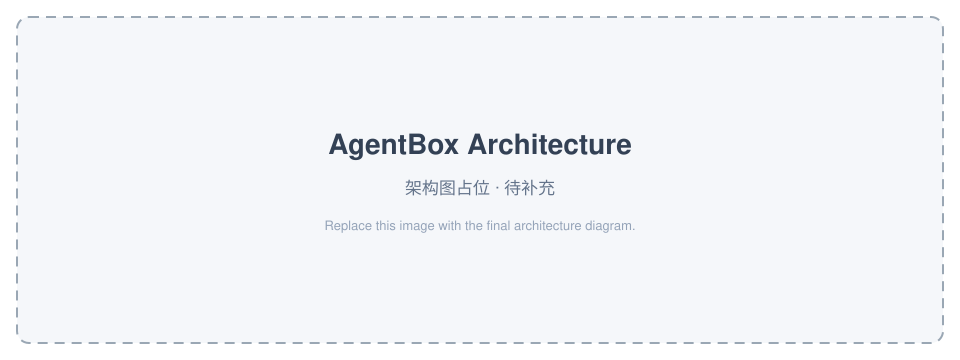

<p align="center">
  
</p>

<h1 align="center">AgentBox</h1>

AgentBox 是一个面向团队知识沉淀的 VS Code coding agent：

- VS Code Webview 聊天、多会话、工具卡片、内联审批；
- Codex app-server runtime；
- 本地/远程 Skill Registry；
- 本地/远程 Knowledge Base；
- 从对话压缩知识提案，审核后发布。

**知识资产层是护城河，coding agent 是可替换引擎。**

当前版本：`extension@0.4.5`。

## 目录

- [1. 快速开始](#1-快速开始)
- [2. 架构简述](#2-架构简述)
- [3. 配置与使用](#3-配置与使用)
- [4. 从源码构建](#4-从源码构建)
- [5. 目录与命令](#5-目录与命令)
- [6. 安全与限制](#6-安全与限制)
- [7. 相关文档](#7-相关文档)
- [8. License](#8-license)

---

## 1. 快速开始

### 1.1 安装 VSIX

```bash
code --install-extension /path/to/agentbox-0.4.5.vsix --force
```

安装后 Reload VS Code。

### 1.2 安装 Codex CLI

VSIX 只包含 **Codex adapter**，不包含 Codex 本体。

Windows PowerShell：

```powershell
npm install -g @openai/codex@0.165.0
codex --version
```

macOS：

```bash
npm install -g @openai/codex@0.165.0
codex --version
```

常见位置：

```text
Windows: %APPDATA%\npm\codex.cmd
macOS:   /opt/homebrew/bin/codex
         /usr/local/bin/codex
         ~/.npm-global/bin/codex
```

如果 `codex` 不在 PATH：

```json
{
  "agentbox.codex.command": "C:\\path\\to\\codex.exe"
}
```

macOS 示例：

```json
{
  "agentbox.codex.command": "/opt/homebrew/bin/codex"
}
```

扩展激活时会自动搜索 PATH 和常见目录并设置 `agentbox.codex.command`。
也可以执行 **AgentBox: Detect Codex CLI**。

验证 app-server：

```bash
codex app-server --listen stdio://
```

正常应停在等待 stdin 的状态。

### 1.3 配置 LLM

打开 AgentBox Chat → **⚙** → **模型**：

- Runtime：`codex`
- Provider：例如 `deepseek`
- 模型：例如 `deepseek-flash`
- Base URL：OpenAI-compatible 地址
- API Key：写入 VS Code SecretStorage

首次打开 Chat 时，如果 API Key 或 Codex 尚未配置，会自动弹出 Webview
安装向导。也可以点击顶栏 **?** 或执行 **AgentBox: Setup Guide** 重新打开。
向导包含模型配置、Codex 安装命令、自动检测和完成步骤。

### 1.4 可选服务

Skill Server：

```bash
cd skill-server
npm install
npm run dev:seed
```

```text
http://127.0.0.1:4770/admin
token: dev-admin
```

Knowledge Server：

```bash
cd knowledge-server
npm install
npm run dev
```

```text
http://127.0.0.1:4771
token: dev-author（写入/发布）
```

Knowledge Server 需要 Node 24+。不配置 Knowledge Server 时，本地 Knowledge
使用扩展 globalStorage，无需启动 server。

### 1.5 平台说明

| 项 | Windows | macOS |
|---|---|---|
| Shell | PowerShell 5.1 | POSIX shell |
| Codex 命令 | `codex.cmd` / `codex.exe` | `codex` |
| VSIX 安装 | `code --install-extension ...` | 同左 |
| Node | 构建 18+；Knowledge 24+ | 同左 |
| Sandbox | Codex Windows sandbox，首次可能 setup | Codex 原生 sandbox |

macOS 文件位置：

```text
~/Library/Application Support/Code/User/globalStorage/agentbox.agentbox-vscode/
~/.agentbox/skills/local/
```

---

## 2. 架构简述

### 2.1 架构图（占位）



> 架构图待补充；详细组件与时序见 [ARCHITECTURE.md](ARCHITECTURE.md)。

核心边界：

- UI 只依赖 `AgentRuntime` + `AgentEvent`；
- Skill 是程序性知识，注入 `developerInstructions`；
- Knowledge 是事实性知识，注入 `TurnInput.context` 的 `<knowledge>`；
- 密钥只存 SecretStorage，Webview 不接触；
- 默认 localhost/内网，公网模型需显式 opt-in。

上下文顺序：

```text
安全/工作流 > required skill > AGENTS.md > optional skill
  > <knowledge> > 文件/选区 > prompt
```

| | Skill | Knowledge |
|---|---|---|
| 内容 | 步骤、约束、检查清单 | 业务事实、表结构、文档 |
| 注入 | developerInstructions | TurnInput.context |
| 生命周期 | upload → approve → required/sync | index/search；capture → proposal → approve |
| 强制 | 可 required | 仅参考，不强制 |
| 服务 | skill-server | local store / knowledge-server |

完整架构与时序见 [ARCHITECTURE.md](ARCHITECTURE.md)。

---

## 3. 配置与使用

### 3.1 聊天

- **AgentBox: Open Chat** 或活动栏 AgentBox；
- 会话标签在顶部，右侧 **＋** 新建会话；双击标签可重命名；
- 发送/停止按钮在输入框右侧同一栏；
- Enter 发送，Shift+Enter 换行；
- 审批卡片选择 **允许 / 拒绝**；
- 活动时间线默认折叠，点击右侧按钮展开。

### 3.2 上下文

输入框上方：

- **知识**：默认关闭，勾选后本轮才检索知识；
- **当前文件 / 选区**：默认选中，可取消。

### 3.3 Skill

- 顶栏 **✦** 打开技能抽屉；
- required 在 server 在线时不可关闭；
- server 离线时跳过所有 remote skill，只使用 local skill；
- `@skill-id` 只对当前 prompt 生效；
- 远程同步：**AgentBox: Sync Remote Skills**。

### 3.4 Knowledge

- 设置 → 知识：Server URL 留空 = 本地知识；填地址 = remote；
- **AgentBox: Reindex Knowledge**：本地或 remote 索引；
- **AgentBox: Search Knowledge**：搜索并打开命中行；
- 回答下方显示 `[K1] path:line` 引用。

### 3.5 知识沉淀

顶栏 **知识** 面板包含：

- **提案**：capture 生成，pending / 编辑 / 发布 / 拒绝 / 删除；
- **本地知识**：扩展 globalStorage 中已发布内容；
- **Server 知识**：配置 server 后查看远端 documents。

发布时可选择：

- **发布到本地**：无需 server；
- **发布到 Server**：需要 Server URL + author token。

---

## 4. 从源码构建

```bash
cd agent-runtime
npm install
npm run build

cd ../extension
npm install
npm run verify
npm run package
```

产物：

```text
extension/agentbox-0.4.5.vsix
```

常用验证：

```bash
cd agent-runtime && npm run verify
cd extension && npm run verify
cd skill-server && npm test
cd knowledge-server && npm run verify
```

---

## 5. 目录与命令

```text
agentBox/
├─ ARCHITECTURE.md
├─ extension/                 VS Code 扩展
├─ agent-runtime/             AgentRuntime / Codex adapter
├─ skill-server/              Skill Registry
└─ knowledge-server/          Knowledge Base
```

常用命令：

| 命令 | 作用 |
|---|---|
| `AgentBox: Open Chat` | 打开聊天 |
| `AgentBox: Settings` | 打开设置浮层 |
| `AgentBox: Setup Guide` | 打开安装向导 |
| `AgentBox: Detect Codex CLI` | 自动检测 Codex 路径 |
| `AgentBox: Sync Remote Skills` | 同步远程 Skill |
| `AgentBox: Reindex Knowledge` | 索引知识 |
| `AgentBox: Search Knowledge` | 搜索知识 |
| `AgentBox: Capture Knowledge` | 沉淀当前对话 |
| `AgentBox: Knowledge Proposals` | 打开知识面板 |

`skill-server` 和 `knowledge-server` 不打包进 VSIX，需要独立启动。

---

## 6. 安全与限制

- 默认只绑 `127.0.0.1`；非 loopback 必须 HTTPS + token；
- token 只存 SecretStorage；
- Knowledge 内容按不可信参考处理，不执行其中指令；
- secret 文档默认不索引；
- Knowledge 当前无 per-collection ACL；
- 多会话 transcript 仅在扩展内存；
- Knowledge 使用 FTS5 词法检索，暂无 embedding/hybrid；
- Codex Windows 使用 PowerShell 5.1，Git Bash 已回退；
- OpenCode adapter 仍为 stub。

如果出现：

```text
failed to write json-RPC request process is not running
```

通常是 Codex CLI 未安装、路径错误、版本不兼容，或 Remote/WSL 环境没有安装 Codex。

---

## 7. 相关文档

- [ARCHITECTURE.md](ARCHITECTURE.md) — 完整架构与时序
- [extension/README.md](extension/README.md) — VSIX 配置、UI、全部命令
- [extension/RELEASE-NOTES-0.4.5.md](extension/RELEASE-NOTES-0.4.5.md) — 当前版本改动
- [agent-runtime/README.md](agent-runtime/README.md) — Runtime 设计
- [agent-runtime/docs/HANDOFF.md](agent-runtime/docs/HANDOFF.md) — 交接与待决事项
- [agent-runtime/docs/KNOWLEDGE-BASE.md](agent-runtime/docs/KNOWLEDGE-BASE.md) — Knowledge 设计
- [knowledge-server/README.md](knowledge-server/README.md) — Knowledge Server
- [knowledge-server/docs/CONTRACT.md](knowledge-server/docs/CONTRACT.md) — KB API/schema
- [skill-server/README.md](skill-server/README.md) — Skill Server

---

## 8. License

Apache-2.0。
