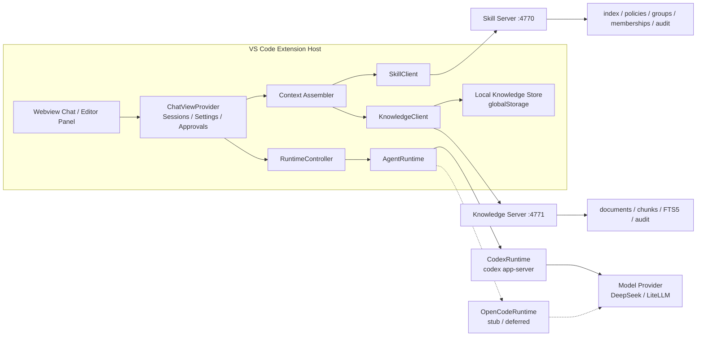

# AgentBox

AgentBox 是一个面向团队知识沉淀的 VS Code coding agent：

- **VS Code Webview Chat**：多会话、流式输出、工具卡片、内联审批、Stop；
- **Codex Runtime**：通过 `codex app-server` 执行编码任务；
- **Skill Registry**：团队 Skill 的上传、审批、required、分组和客户端同步；
- **Knowledge Base**：workspace / 团队知识检索，top-k 注入与引用跳转；
- **Knowledge Capture**：从对话中压缩出知识提案，用户审核后发布。

产品判断：**知识资产层是护城河，coding agent 是可替换引擎。**

---

## 目录

- [1. 当前状态](#1-当前状态)
- [2. 架构要点](#2-架构要点)
  - [2.1 分层](#21-分层)
  - [2.2 总体架构图](#22-总体架构图)
  - [2.3 Skill 与 Knowledge 的关系](#23-skill-与-knowledge-的关系)
  - [2.4 一次 Chat Turn](#24-一次-chat-turn)
  - [2.5 本地 Knowledge Capture](#25-本地-knowledge-capture)
  - [2.6 关键边界](#26-关键边界)
- [3. 目录结构](#3-目录结构)
- [4. 前置条件](#4-前置条件)
- [5. 快速开始](#5-快速开始)
- [6. 常用命令](#6-常用命令)
- [7. 使用方式](#7-使用方式)
- [8. 安全与边界](#8-安全与边界)
- [9. 已知限制](#9-已知限制)
- [10. 相关文档](#10-相关文档)
- [11. License](#11-license)

---

## 1. 当前状态

| 模块 | 版本/状态 | 说明 |
|---|---|---|
| `extension/` | 0.4.0 | VS Code 侧边栏/编辑器聊天、Skill/Knowledge UI |
| `agent-runtime/` | 0.1.0 | Codex app-server adapter、统一 AgentEvent |
| `skill-server/` | 0.1.0 | Skill Registry、审批、required、groups |
| `knowledge-server/` | 0.1.0 | Node 24 + SQLite FTS5、upsert/search/citations |
| OpenCode adapter | 暂缓 | `AgentRuntime` 契约已预留 |
| Runtime 解耦 | 暂缓 | 见 [HANDOFF](agent-runtime/docs/HANDOFF.md) PENDING-1 |

默认运行环境：Windows 11 + PowerShell 5.1；Codex runtime 不使用 Git Bash。

---

## 2. 架构要点

完整架构和时序见 [ARCHITECTURE.md](ARCHITECTURE.md)。本节放 README 里最重要的
部分：总体架构图、Skill 与 Knowledge 的关系、一次 Turn 的数据流。

### 2.1 分层

```text
知识资产层
  Skill Server / Knowledge Server
        ↑
产品体验层
  VS Code Webview / 会话 / 审批 / 引用 / 提案
        ↑
运行时层
  AgentRuntime / Codex / OpenCode（暂缓）/ Fake
        ↑
模型与执行环境
  LiteLLM / DeepSeek / Qwen / PowerShell / Codex sandbox
```

### 2.2 总体架构图



本地部署：

```text
VS Code
  ├─ AgentBox extension
  ├─ codex.exe app-server (stdio)
  ├─ skill-server      http://127.0.0.1:4770
  └─ knowledge-server  http://127.0.0.1:4771
```

### 2.3 Skill 与 Knowledge 的关系

两者都属于 Context 层，但解决的问题不同：

| 维度 | Skill | Knowledge |
|---|---|---|
| 定位 | **程序性知识**：怎么做、步骤、约束、检查清单 | **事实性知识**：业务规则、表结构、接口说明、历史决策 |
| 典型内容 | 编码规范、安全要求、排障流程、提交规范 | SQL 表结构、ETL 说明、接口文档、排障结论 |
| 存储 | `skill.json` + `SKILL.md`，不可变版本 | `documents` + `chunks` + FTS5 索引 |
| 生命周期 | upload → pending → approve/reject → required/enabled → sync | scan/push → chunk → index；capture → proposal → approve → publish |
| 激活方式 | required / optional / `@skill` mention | 每轮 top-k 检索，或显式搜索 |
| 注入位置 | `developerInstructions` | `TurnInput.context` 的 `<knowledge>` |
| 是否可强制 | 可以 required，客户端不可关闭 | 不做 required；只作为参考证据 |
| 冲突优先级 | required skill > 项目 `AGENTS.md` > optional skill | Knowledge 低于 Skill/项目指令；冲突时 Skill/项目指令赢 |
| 服务 | `skill-server` :4770 | 本地 globalStorage 或 `knowledge-server` :4771 |
| 审核对象 | Skill 包版本 | Knowledge proposal / document |
| 引用能力 | 版本/hash/来源 | path / heading / line range / citation |

关系可以概括为：

```text
Skill：告诉 Agent “应该怎么做”
Knowledge：告诉 Agent “事实是什么、依据在哪里”
```

Knowledge 不负责规定流程；Skill 不适合承载大量事实文档。

如果 Skill 需要引用事实，可以引用 Knowledge；Knowledge 冲突时不能覆盖 required Skill
或项目指令。

Context 组装顺序：

```text
内置安全/工作流
  > remote required skill
  > 项目 AGENTS.md
  > local/optional skill
  > <knowledge> top-k
  > 当前文件/选区
  > 用户 prompt
```

### 2.4 一次 Chat Turn

```text
用户 prompt
  → SkillClient 读取缓存 / required
  → KnowledgeClient 检索 top-k
  → ContextAssembler 组装：
       skill > AGENTS.md > optional skill > <knowledge> > file/selection
  → RuntimeController.runTurn()
  → Codex app-server
  → AgentEvent 流
  → Webview 渲染文本 / 工具 / 审批
  → 回答 + [K1] citations
```

Skill 同步与 Knowledge 入库是两条独立链路：

```text
Skill:
  upload → pending → reviewer approve → required/enabled
  → client sync → 本地缓存 → 注入 developerInstructions

Knowledge:
  workspace scan / remote push → upsert → chunk → FTS5
  → search → top-k chunks → <knowledge> → citations
```

### 2.5 本地 Knowledge Capture

```text
Webview「知识」按钮
  → Capture Knowledge
  → 独立临时 runtime 压缩当前 turn
  → 本地 pending proposal
  → 用户编辑 / 通过 / 拒绝
  → approve 后发布到本地存储或 knowledge-server（取决于 Server URL）
```

Local 由当前用户自己审核；Remote proposal 的客户端/provider 接口已定义，
服务端 proposal/review API 待实现。

Capture 产出的是 **Knowledge proposal**，不是 Skill。

如果未来要从对话沉淀 Skill，需要单独的 Skill proposal/review 流程。

### 2.6 关键边界

- UI/Controller 只依赖 `AgentRuntime` + `AgentEvent`，不直接依赖 Codex 私有类型；
- Knowledge 只进入 `TurnInput.context`，**不写入 `developerInstructions`**；
- Skill 是程序性规则，Knowledge 是事实性参考资料；
- 密钥只在 Extension Host / SecretStorage，Webview 不接触 token；
- 默认内网/localhost；公网模型必须显式 opt-in、告警、审计；
- 文件操作限制在 workspace；shell 走审批和 Codex sandbox；
- `agent-runtime/src` 不 import `vscode`。

---

## 3. 目录结构

```text
agentBox/
├─ README.md                 # 本文件
├─ ARCHITECTURE.md           # 系统架构
├─ extension/                # VS Code 扩展（Webview + host）
├─ agent-runtime/            # AgentRuntime / AgentEvent / Codex adapter
│  └─ docs/                  # HANDOFF / MODULES / KNOWLEDGE-BASE / SKILL-*
├─ skill-server/             # Skill Registry HTTP 服务
└─ knowledge-server/         # Knowledge Base HTTP 服务
   └─ docs/CONTRACT.md       # Knowledge API/schema/chunk 契约
```

各子目录是独立 npm package，没有根 workspace。

`skill-server/` 和 `knowledge-server/` **不会打包进 VSIX**；它们是独立进程，
需要单独启动或部署。VSIX 只包含扩展宿主代码、Webview 资源、媒体文件，以及
扩展本地知识/提案存储逻辑。Server URL 为空时，Knowledge 使用扩展
`globalStorage` 中的本地存储，不需要启动 knowledge-server。

---

## 4. 前置条件

| 项 | 要求 |
|---|---|
| OS | Windows 11（当前主要开发环境） |
| Node | 只使用 VSIX 不需要；从源码构建需 Node 18+；`knowledge-server` 必须 **Node 24+** |
| VS Code | 1.85+ |
| Codex CLI | 已安装并 pin 版本；VSIX 不打包二进制（`codex --version` 可验证） |
| 模型 | DeepSeek 或内网 OpenAI-compatible provider |
| 网络 | 默认 localhost/内网；公网模型需显式配置 |
| Shell | Codex 使用 PowerShell 5.1；Git Bash 已回退 |

`knowledge-server` 使用 Node 24 内置 `node:sqlite`，启动时会有
`ExperimentalWarning`，属正常现象。

---

## 5. 快速开始

### 5.1 最简使用（已有 VSIX，推荐新设备）

如果只是使用 AgentBox，不需要 Node/npm 构建：

1. 安装 VSIX：

```powershell
code --install-extension "D:\path\to\agentbox-0.4.0.vsix" --force
```

2. 安装 Codex CLI，并确认命令可用：

```powershell
codex --version
```

如果 `codex` 不在 PATH，在 AgentBox 设置 → 高级中把 **Codex 命令** 改成绝对路径，
例如 `D:\tools\codex\codex.exe`。

3. Reload VS Code，打开一个工作区。

4. 打开 AgentBox Chat → **⚙**，配置：

- Runtime：`codex`
- Provider / 模型 / Base URL
- API Key（写入 SecretStorage）

5. 发送一条测试 prompt。首次 Windows 运行可能需要 Codex sandbox 初始化。

**VSIX 内容说明**：

| 内容 | 是否包含 |
|---|---|
| AgentBox extension / Webview | ✅ |
| `AgentRuntime` + `CodexRuntime` adapter | ✅（编译进 `dist/extension.js`） |
| Codex CLI 二进制 `codex.exe` | ❌ 需本机安装 |
| `skill-server` / `knowledge-server` | ❌ 独立服务 |

> VSIX 包含“调用 code agent 的 adapter”，不包含 code agent 本体。

可选能力：

- 本地 Skill：无需 server，放到 `~/.agentbox/skills/local/`；
- 本地 Knowledge：无需 server，使用扩展 `globalStorage`；
- 远程 Skill/Knowledge：分别启动 `skill-server` / `knowledge-server`。

### 5.2 从源码构建 runtime

```powershell
cd agent-runtime
npm install
npm run build
```

### 5.3 启动 Skill Server（可选）

只有使用远程 Skill 时才需要；本地 Skill 不依赖该服务。

```powershell
cd skill-server
npm install
npm run dev:seed
```

- 地址：`http://127.0.0.1:4770`
- 管理页：`http://127.0.0.1:4770/admin`，开发模式自动登录
- 扩展本地 loopback 读取可匿名；上传/审批需要 `dev-author` / `dev-admin`

### 5.4 启动 Knowledge Server（使用远程/共享知识库时需要）

`agentbox.knowledge.serverUrl` 为空时使用扩展本地知识存储（`globalStorage`），
不需要启动 server；不影响普通聊天。

```powershell
cd knowledge-server
npm install
npm run dev
```

- 地址：`http://127.0.0.1:4771`
- dev token：`dev-author`（写入/发布）、`dev-reader`、`dev-admin`
- 数据目录：`.knowledge-data/`

### 5.5 构建并安装扩展

```powershell
cd extension
npm install
npm run package
code --install-extension "agentbox-0.4.0.vsix" --force
```

产物：`extension/agentbox-0.4.0.vsix`。安装后 Reload Window。
Codex 二进制不打包在 VSIX 中，需要在本机单独安装或配置绝对路径。

### 5.6 配置扩展

打开 AgentBox Chat，点击右上角 **⚙**，在设置浮层中配置：

- **模型**：Runtime、Provider、模型、Base URL、API Key；
- **Skill**：Skill Server URL、Token、自动同步、required 策略、本地目录；
- **知识**：Knowledge Server URL、Token、自动检索、Top K、最大字符；
- **高级**：Codex 命令路径、额外指令。

API Key / Server Token 只写入 VS Code **SecretStorage**，不会回传 Webview。

本地联调示例：

```json
{
  "agentbox.runtime": "codex",
  "agentbox.codex.model": "deepseek-flash",
  "agentbox.codex.provider": "deepseek",
  "agentbox.codex.baseUrl": "https://api.deepseek.com",
  "agentbox.codex.apiKeyEnv": "DEEPSEEK_API_KEY",
  "agentbox.skills.serverUrl": "http://127.0.0.1:4770",
  "agentbox.knowledge.serverUrl": "http://127.0.0.1:4771"
}
```

Knowledge 写入需要 author token：

```text
Server Token: dev-author
```

---

## 6. 常用命令

### 扩展

```powershell
cd extension
npm run build
npm run test
npm run verify
npm run package
```

### Runtime

```powershell
cd agent-runtime
npm run verify
```

### Skill Server

```powershell
cd skill-server
npm test
```

### Knowledge Server

```powershell
cd knowledge-server
npm run verify
```

---

## 7. 使用方式

### 7.1 聊天

1. 打开一个临时 workspace；
2. 执行 **AgentBox: Open Chat**，或点击活动栏 AgentBox；
3. 输入任务，Enter 发送，Shift+Enter 换行；
4. 在审批卡片选择 **允许 / 拒绝**；
5. 运行中点击同一按钮 **停止**。

### 7.2 Skill

- 顶栏 **✦** 打开技能抽屉；
- required skill 默认勾选且不可关闭；
- 输入 `@skill-id` 只对当前 prompt 生效；
- 远程 Skill 通过 **AgentBox: Sync Remote Skills** 同步；
- server 离线时跳过所有 remote skill（包括 cached required），只使用 local skill；
- 组权限通过设置 → Skill → Skill Groups 申请。

### 7.3 Knowledge

- 设置 → 知识：Server URL 留空 = 本地知识；填地址 = 远程/共享知识；
- 输入框上方 **知识** 按钮默认关闭；勾选后该轮才检索知识，避免 token 消耗；
- **知识** 面板包含 **提案 / 本地知识 / Server 知识** 三个 Tab；
- **AgentBox: Reindex Knowledge** 扫描 workspace；
- **AgentBox: Search Knowledge** 搜索并打开命中行；
- 回答下方显示 `[K1] path:line`，点击打开源文件。

### 7.4 知识沉淀

1. 完成一轮对话；
2. 顶栏 **知识** → **沉淀当前对话**；
3. 等待 capture workflow 生成 pending proposal；
4. 点击 **编辑** 修改 Markdown；
5. 审核时可选择 **发布到本地** 或 **发布到 Server**：
   - 本地：写入扩展 globalStorage；
   - Server：需要先在设置中配置 Knowledge Server URL；
6. rejected 提案可点击 **删除**；本地/Server 知识可在对应 Tab 查看并打开；
6. 拒绝则标记为 rejected。

---

## 8. 安全与边界

- 默认只绑定 `127.0.0.1`；
- 非 loopback 的 Knowledge Server 必须 HTTPS + token；
- token 只存 SecretStorage，不进 `settings.json`、Webview、日志；
- Knowledge 检索内容按不可信参考处理，不执行其中指令；
- secret 文档默认不索引；server 侧会做 redaction；
- 本地 capture proposal 在用户审核前不进入检索；
- 公网模型会把 prompt/tool 输出发到外部 provider，生产应使用内网模型；
- 当前 Knowledge MVP **没有 per-collection ACL**，不要直接暴露给不受信任的团队；
- 不要修改历史 `pluginVersion/`；新功能都在 `extension/`、`agent-runtime/`、
  `skill-server/`、`knowledge-server/`。

---

## 9. 已知限制

- 多会话 transcript 只在扩展内存，Reload 后清空；
- Codex Windows 使用 PowerShell 5.1，Git Bash runtime 暂缓；
- OpenCode adapter 仍是 stub；
- Knowledge 索引是手动/命令触发，没有文件 watcher；
- Knowledge 当前是 FTS5 词法检索，没有 embedding/hybrid；
- Capture 会启动独立临时 runtime，首次执行有 Codex 启动开销；
- Remote Knowledge proposal/review API 尚未实现；
- 引用行号是索引时快照，文件变化后可能 stale。

---

## 10. 相关文档

- [ARCHITECTURE.md](ARCHITECTURE.md) — 系统级架构
- [extension/README.md](extension/README.md) — VSIX 安装、配置、UI、命令
- [agent-runtime/README.md](agent-runtime/README.md) — Runtime 设计与 quick start
- [agent-runtime/docs/MODULES.md](agent-runtime/docs/MODULES.md) — 模块/契约 ADR
- [agent-runtime/docs/HANDOFF.md](agent-runtime/docs/HANDOFF.md) — 当前交接与待决事项
- [agent-runtime/docs/SKILL-SYSTEM.md](agent-runtime/docs/SKILL-SYSTEM.md) — Skill 设计
- [agent-runtime/docs/KNOWLEDGE-BASE.md](agent-runtime/docs/KNOWLEDGE-BASE.md) — Knowledge 设计
- [knowledge-server/README.md](knowledge-server/README.md) — Knowledge Server 运行
- [knowledge-server/docs/CONTRACT.md](knowledge-server/docs/CONTRACT.md) — KB API/schema/chunk
- [skill-server/README.md](skill-server/README.md) — Skill Server 运行/API

---

## 11. License

Apache-2.0。第三方组件许可见各目录 `LICENSE` / `NOTICE`。
