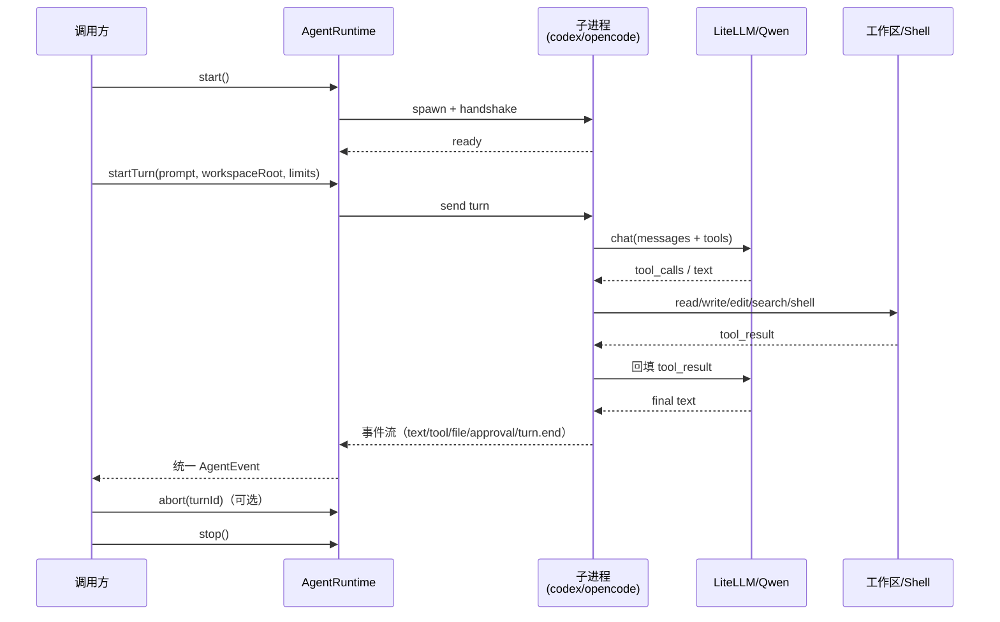

# Agent Runtime 架构

> 本文件描述本阶段（运行时层）的架构；知识/Skill/UI 在下一阶段接入。
> 详细任务见 [../IMPLEMENTATION_PLAN.md](../IMPLEMENTATION_PLAN.md)。

---

## 1. 分层

```
┌─────────────────────────── 调用方（VS Code / CLI / 测试） ───────────────────────────┐
│  Turn Orchestrator · Context Builder · Policy/Approval · Event Bus · Session Store    │
└───────────────────────────────────┬─────────────────────────────────────────────────┘
                                    │ AgentRuntime（统一接口）
              ┌─────────────────────┼─────────────────────┐
              ▼                     ▼                     ▼
      ┌──────────────┐      ┌──────────────┐      ┌──────────────┐
      │ CodexRuntime │      │ OpenCode     │      │ OpenClaw     │
      │ 主             │      │ Runtime 备选  │      │ 弃用           │
      └──────┬───────┘      └──────┬───────┘      └──────────────┘
             │ stdio JSON-RPC        │ HTTP/SSE
             ▼                       ▼
      codex app-server         opencode serve
             │                       │
             └───────────┬───────────┘
                         ▼
              工作区文件 / PowerShell / 终端
                         │
                         ▼
          LiteLLM → Qwen3-Coder（内网，OpenAI-compatible）
```

**依赖方向：**

```
调用方 → AgentRuntime ← CodexRuntime / OpenCodeRuntime
```

`agent-runtime/src` **禁止 import `vscode`**，也禁止 import `pluginVersion` 里的代码。
VS Code 代码放在独立包 `extension/`，通过 `AgentRuntime` + `AgentEvent` 消费本包。
薄消费者（V1–V4）用于端到端验证；完整产品 UI 在下一阶段。

---

## 2. 一次 turn 的时序



---

## 3. 统一事件

所有 adapter 必须把 runtime 私有事件映射成下面这套：

```ts
type AgentEvent =
  | { type: 'turn.start'; turnId: string; runtime: RuntimeId; at: number; metadata?: Record<string, unknown> }
  | { type: 'text.delta'; turnId: string; text: string; at: number }
  | { type: 'tool.start'; turnId: string; callId: string; name: string; args: unknown; at: number }
  | { type: 'tool.end'; turnId: string; callId: string; name: string; ok: boolean; result: string; at: number }
  | { type: 'approval.request'; turnId: string; callId: string; name: string; args: unknown; at: number }
  | { type: 'file.changed'; turnId: string; path: string; at: number }
  | { type: 'token.usage'; turnId: string; usage: TokenUsageSnapshot; at: number }
  | { type: 'turn.end'; turnId: string; reason: StopReason; at: number }
  | { type: 'error'; turnId: string; code: string; message: string; at: number };
```

事件契约版本：`AGENT_EVENT_SCHEMA_VERSION = 1`（`src/types.ts` 导出）；破坏性变更必须递增。

约定：

- `text.delta` 只放增量文本，UI 自己拼接。
- `token.usage` 为**可选、非破坏性**事件：Codex 映射 `thread/tokenUsage/updated`，
  携带 `last`（本轮）与 `total`（线程/会话累计）token 用量；不支持该能力的 runtime 不发。
- `tool.start` / `tool.end` 必须成对；失败时 `ok=false`，`result` 放错误摘要。
- `approval.request` 只表示"需要审批"；调用方通过 `resolveApproval(turnId, callId, 'allow' | 'deny')`
  回执，adapter 必须把决定回传给子进程。**被拒绝的工具不得执行**；若因此结束 turn，
  `turn.end.reason = 'policy_denied'`。
- `turn.end` 必须最终发出一次，带上 `StopReason`；**恰好一次**。超时/进程崩溃由守卫兜底发
  `error` + `turn.end('error')`。`turn.end` 之后同一 turnId 的事件一律丢弃。
- 每个 runtime 实例**同一时刻只有一个活动 turn**；并发 `startTurn` 抛 `TURN_IN_PROGRESS`。
- `file.changed.path` 统一为 **workspace 相对路径、POSIX 分隔符、无前导 `/`、无 `..`**。
- `turn.start.metadata` 只回显可 JSON 序列化、不含密钥的调用方元数据。
- 事件里不要放密钥、完整环境变量、超长输出（截断到 `maxOutputCharsPerTool`）。
- Limits 优先级：`DEFAULT_LIMITS` < `RuntimeConfig.limits` < `TurnInput.limits`（partial 覆盖）。

---

## 4. Adapter 能力声明

两个 runtime 能力不完全一样，调用方不能假设：

```ts
interface RuntimeCapabilities {
  streaming: boolean;
  toolEvents: boolean;
  fileEvents: boolean;
  approvals: boolean;
  mcp: boolean;
  protocolVersion?: string;
}
```

- Codex：预计 `streaming/toolEvents/fileEvents/approvals/mcp` 都有，**以 Phase 0 实测为准**。
- OpenCode：预计 `streaming/toolEvents/approvals/mcp` 有；`fileEvents` 可能弱，需实测。
- 调用方根据 capability 降级（例如没有 `fileEvents` 就用 `Workspace` watcher 兜底）。
- `mcp` 本阶段仅作能力声明，`AgentEvent` 没有 MCP 事件；MCP 工具接入在下一阶段。

---

## 5. 安全边界

```
┌─ Zone A：开发者机器 ──────────────┐     ┌─ Zone B：内网 ─────────────────────┐
│ agent-runtime 进程                │     │ knowledge platform（下一阶段）      │
│ 子进程：codex / opencode          │────▶│ LiteLLM + Qwen3-Coder               │
│ 工作区文件 + PowerShell           │     │ DB / object store / audit（下一阶段）│
└───────────────────────────────────┘     └────────────────────────────────────┘
                                                          │ 默认禁止
                                                          ▼
                                                ┌─ Zone C：外部（默认关闭）─┐
                                                │ 经审批的模型/知识库通道    │
                                                └───────────────────────────┘
```

规则：

- **默认内网**：默认模型出口是内网 LiteLLM，不出网。
- **公网模型为显式例外（2026-10-28 决策）**：用户可配置公网 OpenAI-compatible 提供商
  （Zone C），必须 opt-in、界面告警、可审计；默认关闭。秘密级数据禁止发送到公网模型。
- Codex 需要 Responses API；OpenCode 使用 chat completions；配置层需表达 `wireApi`/提供商差异。
- 关闭 Codex/OpenCode 的遥测、自动更新、云端登录；用断网环境验证。
- 子进程只监听 localhost；不暴露 0.0.0.0。
- 文件工具限制在 `workspaceRoot`；shell 走 allowlist + 审批。
- 子进程环境变量最小化；不要把 `MODEL_API_KEY` 之外的密钥传进去。
- 日志/事件中脱敏：token、cookie、绝对路径可按需替换。
- 许可证：Codex 为 Apache-2.0，OpenCode 为 MIT；保留 NOTICE/attribution。

---

## 6. 与下一阶段的接口

下一阶段的 VS Code 插件只需要：

1. 构造 `RuntimeConfig`（runtime、workspaceRoot、limits、命令/端口、模型提供商）。
   模型提供商需包含 `baseUrl`、`apiKeyEnv`、`model`、`wireApi` 与 `scope`（internal/external）；
   `scope=external` 必须由用户显式确认。
2. `createRuntime(config)` → `start()`。
3. `startTurn()` + `onEvent()` 驱动 UI；审批时调用 `resolveApproval(turnId, callId, decision)`。
4. `abort()` / `stop()` 处理取消和窗口关闭。

知识/Skill 注入的预留点：

- `TurnInput.context`：调用方把知识/Skill 片段拼好后传入；runtime 不关心来源。
- 后续可把 `TurnInput.context` 换成 MCP 工具调用；adapter 不需要改。
- 捕获所需的事件（tool calls、file changed、turn end）已经包含在 `AgentEvent` 里。

---

## 7. 非目标（本阶段）

- 不实现知识库、Skill Registry、采集 pipeline、文档模板。
- 不实现**完整** VS Code 产品 UI（Chat 面板、TreeView、diff 面板、知识/资产视图）。
  但允许并建议一个**薄消费者**（`extension/`，V1–V4）用于端到端验证与打包。
- 不实现 OpenClaw adapter，不修改 `pluginVersion/`。
- 不自研 agent loop（Codex/OpenCode 已经是引擎）。
- 不做多 agent、多会话并发、团队协作。
