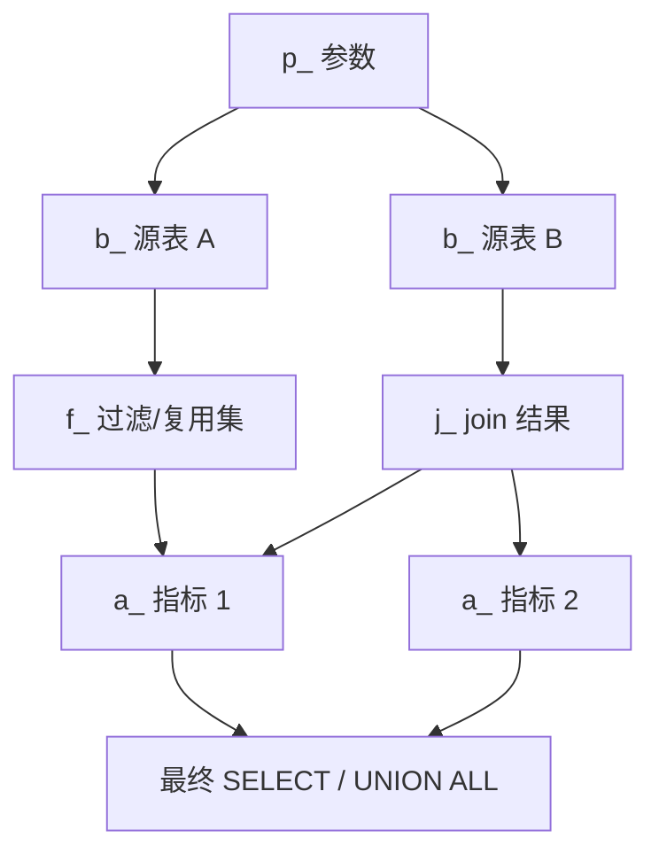

# Mermaid 分层图（可选）

日常评审优先用纯文本树（见 `SKILL.md` 第七节）。需要图片时再复制本模板。

## 预览与导出

- **VS Code**：安装 `Markdown Preview Mermaid Support`，打开本文件预览；不需要装 Chrome。
- **GitHub/GitLab**：Markdown 里的 Mermaid 会直接渲染。
- **导出图片**：优先用 D2 或 Graphviz（单文件工具，不需要 Chrome）。
- `npx @mermaid-js/mermaid-cli -i layers.md -o layers.svg` 会下载 Chromium，日常评审不推荐，只在 CI 或偶尔导出时用。

内部表结构不要贴到公网预览站。
